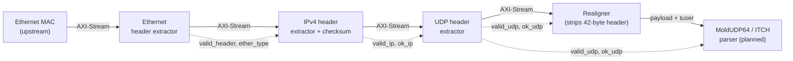

# FPGA Market Data Pipeline

A attempt at a low-latency receive path for exchange market data, written in Verilog.
It takes raw Ethernet frames on a 64-bit AXI-Stream bus, checks the headers
as the bytes stream past (cut-through), and realigns the UDP payload to start
at lane 0 before feeding into a Nasdaq ITCH 5.0 parser.

## Architecture



Each stage passes the stream through unchanged, captures its header fields,
and raises a valid/ok flag once its checks are complete. Verdicts are chained
(`ok_udp` includes `ok_ip`, which includes the Ethernet check). The realigner
delivers the final verdict on `tuser` with the last beat of each frame, so
downstream discards the frame if `tuser = 1` or `!(ok_udp && valid_udp)`.

## Design assumptions

- Untagged Ethernet, IPv4 with IHL = 5, frames of at least 60 bytes
- UDP payload of at least 20 bytes (the MoldUDP64 header size)
- UDP checksum is not verified (a zero checksum is legal and common on feeds)
- The MAC has already removed the preamble and checked the FCS

## Status

| Stage | RTL | cocotb tests | Synthesis |
|---|---|---|---|
| Skid buffer | done | done | done |
| Ethernet header extractor | done | done | done |
| IPv4 header extractor | done | done | done |
| UDP header extractor | done | done | done |
| Realigner | done | done | done |
| ITCH parser | done | done | done |

## Running the tests

Requires Python 3, [Icarus Verilog](https://github.com/steveicarus/iverilog), and:

```bash
python3 -m venv .venv && source .venv/bin/activate
pip install cocotb cocotbext-axi scapy pytest
```

Each testbench lives in its own folder under `tb/`:

```bash
cd tb/<module>
make clean && make
```

The skid buffer takes options: `make clean && make OPT_OUTREG=1 OPT_LOWPOWER=1`.
Set `WAVES = 1` in the Makefile to dump waveforms.

## Synthesis results

Synthesised with Yosys and nextpnr (Lattice ECP5, 64-bit datapath) using
[OSS CAD Suite](https://github.com/YosysHQ/oss-cad-suite-build):

```bash
./synth/run_synth.sh
```

Fmax is post-route and covers flop-to-flop paths only. ECP5 is slower than
the devices used in production, so compare the rows against each other, not
against vendor numbers.


# Skid Buffer Tests

All run with DATA_WIDTH=64 using Yosys and ECP5, combinational input-to-output paths are not included in Fmax numbers.
|                             | LUT4s | FFs | Fmax after Routing/MHz | Critical Path           |
|-----------------------------|-------|-----|------------------------|-------------------------|
| OPT_OUTREG=0 OPT_LOWPOWER=0 | 68    | 65  | 533.62                 | r_valid to r_data       |
| OPT_OUTREG=0 OPT_LOWPOWER=1 | 70    | 65  | 342.82                 | r_valid to r_data       |
| OPT_OUTREG=1 OPT_LOWPOWER=0 | 69    | 130 | 372.02                 | r_valid to o_data       |
| OPT_OUTREG=1 OPT_LOWPOWER=1 | 71    | 130 | 337.61                 | r_valid to r_data       |

# Ethernet Header Extractor Tests

| LUT4s | FFs | Fmax after Routing/MHz | Critical Path             |
|-------|-----|------------------------|---------------------------|
| 17    | 115 | 367.92                 | beat_count to source_MAC  |

# Ethernet and IP Header Extractor Tests

| LUT4s | FFs | Fmax after Routing/MHz | Critical Path             |
|-------|-----|------------------------|---------------------------|
| 314   | 302 | 154.44                 | checksum to checksum      |


# Ethernet, IP, and UDP Header Extractor Tests

| LUT4s | FFs | Fmax after Routing/MHz | Critical Path                                 |
|-------|-----|------------------------|-----------------------------------------------|
| 362   | 371 | 159.03                 | checksum to ok_ip in ip_header_extractor      |


# Ethernet, IP, and UDP Header Extractor with Realigner Tests

| LUT4s | FFs | Fmax after Routing/MHz | Critical Path                                 |
|-------|-----|------------------------|-----------------------------------------------|
| 432   | 552 | 154.46                 | checksum to checksum in ip_header_extractor   |

# Whole Pipeline: Ethernet, IP, UDP, Realigner, and MOLDUDP64 Header Extractors with ITCH Parser

| LUT4s.  | FFs  | Fmax after Routing/MHz | Critical Path                                           |
|---------|------|------------------------|---------------------------------------------------------|
| 10080   | 1559 | 45.75                  | buffer_byte_count to data_buffer in ITCH Parser gearbox |


We note that the performance has dropped significantly and the resources used has increased substantially. Considering the critical path and the timing split between logic and routing (6.18 ns logic, 15.68 ns routing), the critical path has to do with the gearbox. 

Considering data_buffer and buffer_byte_count: 
```verilog
wire [511:0] total_data_buffer = data_buffer | {448'd0, received_data} << {buffer_byte_count, 3'b000};

//some lines later, in a sequential always block
data_buffer <= total_data_buffer >> {bytes_consumed, 3'b000};
```
We note the following:
1. A barrel shifter is used to create total_data_buffer at the correct byte offset
2. Another barrel shifter is used to register data_buffer before the next clock edge
3. Both barrel shifters shift by a variable number of bytes.

This variable number of bytes means that we require many stages of muxes to correctly evaluate the shift. If we were shifting by any number from 0 to 511 bits, we would require 9 stages of multiplexers, but since we are shifting by bytes, we will require log2(512/8) = 6 stages of multiplexers. Each stage operates across the wide data path so the mux networks can be substantial. Having two of these variable shifts contribute significantly to the critical path.

In order to fix this, we have to abandon the shifting architechture entirely if we want to get anywhere near 150 MHz. Instead of shifting data_buffer to get data aligned at position 0, we can consider shifting our position instead. This can be done with a pointer which points to where we should be reading from and a circular data buffer that wraps around. In this case, we should be careful with modular arithmetic, data buffer size and reading fields that cross the end of the buffer. But with a power-of-two buffer size, we can use bit masking to efficiently implement pointer wrapping. With a maximum message length of 50 bytes, a 512-bit circular data buffer should be adequate.
